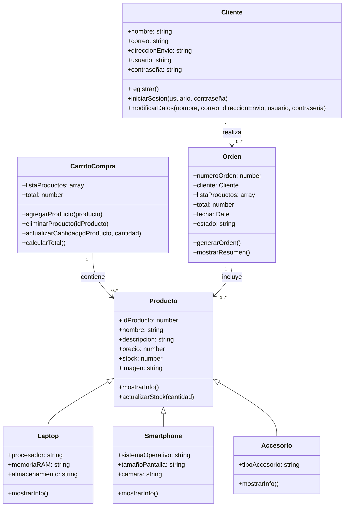

# Diagrama UML del proyecto TecnoCompra

## Descripción breve
- `Cliente` representa al usuario registrado del sistema.
- `Producto` es la clase base para todos los artículos del catálogo.
- `Laptop`, `Smartphone` y `Accesorio` heredan de `Producto` y agregan atributos específicos.
- `CarritoCompra` administra los productos agregados y el total a pagar.
- `Orden` representa la compra confirmada con cliente, productos y resumen final.
